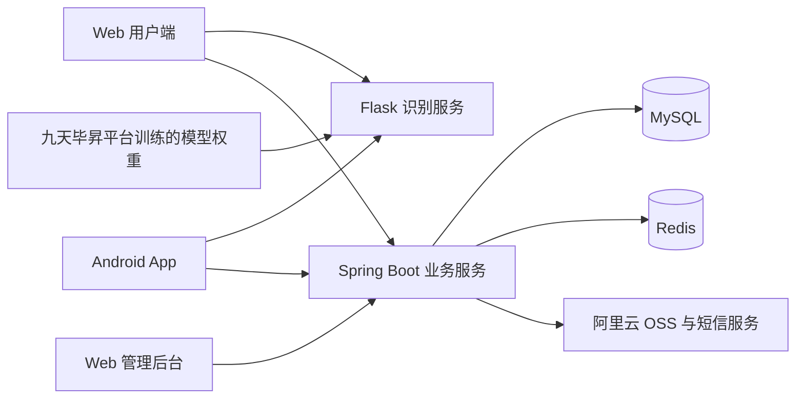

# 智慧农识 ETREES

**基于深度学习的植物表型识别系统，面向农业场景提供植物病虫害识别、实时监测、病害图鉴和农资商城。**

识别模型基于 YOLOv5，由团队使用自建数据集在**中国移动九天毕昇平台**上自主训练。平台将目标检测结果与病害知识、处理建议及相关农资商品关联，帮助用户从发现问题进一步了解和处理病虫害。

## 项目成果

- **人工标注 20 万张次**：使用 LabelImg 进行目标框与类别标注，并结合数据筛选、增强和类别均衡处理构建训练数据。
- **覆盖 6 类作物、26 个识别类别**：包括病虫害表现和健康叶片，支持一张图片中多个目标的识别与定位。
- **提供多种识别方式**：App 拍照、图片上传、摄像头实时监测，以及 Web 端批量识别和智能标注。
- **完成多端平台建设**：用户可通过 Web 和 Android App 使用服务，工作人员通过独立管理后台维护数据与业务。


## 功能介绍

### 用户平台

| 功能 | 说明 | 使用端 |
| --- | --- | --- |
| 图片识别 | 上传图片，返回识别类别、类别数量、推理耗时，并查看目标框标注结果 | Web、App |
| 拍照识别 | 使用手机拍照后提交识别 | App |
| 实时监测 | 展示接入识别服务器的摄像头或视频流及检测结果 | Web、App |
| 批量识别 | 上传图片 ZIP 压缩包，批量推理并下载识别结果 | Web |
| 智能标注 | 上传图片 ZIP 压缩包，生成包含类别和目标框坐标的标注文件并打包下载 | Web |
| 病害图鉴 | 按作物目录浏览或搜索病害，查看多发时期、概述、发病原因和处理方案 | Web、App |
| 农资商城 | 浏览和搜索商品，管理购物车、提交订单、查看订单与维护收货地址 | Web、App |
| 个人中心 | 登录注册、个人资料、密码与绑定手机管理、识别记录和问题反馈 | Web、App |

识别结果页会进一步展示对应病害的图鉴信息与相关商品。实时监测的视频源由服务端接入，手机端拍照则使用手机摄像头。

### 管理后台

| 模块 | 主要功能 |
| --- | --- |
| 数据看板 | 识别、订单、反馈统计，待处理订单数量，近期识别趋势与商品销量图表 |
| 用户管理 | 用户查询、账号启用与禁用 |
| 数据管理 | 病害目录、图鉴信息、健康提示维护与识别记录查询 |
| 员工管理 | 员工账号维护、权限分配与菜单展示 |
| 商城管理 | 商品目录、商品信息与订单处理 |
| 平台维护 | 用户反馈查看与员工操作日志查询 |

## 数据集与模型

### 数据准备与训练

团队围绕植物病虫害识别场景，自行完成数据准备和模型训练：

1. **采集与筛选**：收集植物病虫害图像，筛除无关、无有效目标或质量不符合要求的样本。
2. **人工标注**：使用 LabelImg 标注目标类别和位置，累计完成 20 万张次人工标注。
3. **数据增强**：针对模糊、昏暗、曝光等使用条件构造增强样本，并尽量平衡各类别的数据量。
4. **模型训练**：在中国移动九天毕昇平台上基于 YOLOv5 训练，结合输入尺寸、训练轮次和识别阈值进行调优。
5. **迭代与集成**：分析误识别样本、补充标注并迭代训练，将训练所得权重接入 Flask 服务，供 Web 和 App 调用。

目标检测同时给出类别与位置，可用于多目标识别、结果可视化、实时监测和辅助标注。智能标注生成的结果可供后续人工复核和整理。

### 识别范围

以下类别按归档中的数据配置和中文映射整理，名称沿用项目定义。

| 作物 | 类别数 | 覆盖类别 |
| --- | ---: | --- |
| 番茄 | 10 | 叶斑病、黄叶病、卷曲病毒、粉末状霉菌、晚疫病水霉菌、早疫病、叶斑真菌、叶霉病、蜘蛛螨伤害、健康 |
| 苹果 | 5 | 黑星病、锈病、灰斑病、棕斑病、健康 |
| 玉米 | 4 | 大叶斑病、小叶斑病、锈病、健康 |
| 白菜 | 3 | 霉斑病、虫洞、健康 |
| 葡萄 | 2 | 黑腐病、健康 |
| 草莓 | 2 | 白粉病、健康 |

[voc_label.py](./yolov5/voc_label.py)包含 26 类标签及 VOC 标注转 YOLO 格式的处理逻辑；[split_train_val.py](./yolov5/split_train_val.py)用于划分数据集；[train.py](./yolov5/train.py)为训练入口。完整算法压缩包中的 `data/ab.yaml` 保存了对应的 26 类训练配置。

当前归档保留了训练脚本、配置及模型权重，完整训练图片与人工标注数据集需另行准备。重新训练时，需要同步修改数据路径、类别顺序、模型结构与初始权重配置。

## 技术架构

系统采用前后端分离结构，Python 服务负责模型推理，Java 服务负责用户、图鉴、商城和管理业务。



图片识别时，用户端先上传图片至 Flask 服务，再根据返回的文件名发起推理请求。收到识别结果后，用户端向 Java 服务查询病害与商品信息，并提交识别记录。批量识别和智能标注由 Flask 服务处理 ZIP 文件并提供结果下载。

| 部分 | 技术与用途 |
| --- | --- |
| Web 用户端 | Vue 2、Vue Router、Vuex、Element UI、Axios |
| Web 管理后台 | Vue 2、Element UI、Axios、ECharts |
| Android App | uni-app、HBuilderX，提供 APK 安装包 |
| Java 后端 | Java 8、Spring Boot 2.7.5、MyBatis / MyBatis-Plus、JWT、Spring Security |
| 模型训练与推理 | Python、PyTorch、YOLOv5、OpenCV |
| 识别接口 | Flask、Flask-CORS |
| 数据与外部服务 | MySQL、Redis、阿里云 OSS、短信服务 |
| 构建与部署 | Maven、Vue CLI 5、npm；原部署资料记录使用 Nginx |

## 仓库结构

```text
.
├── backend/
│   ├── Etrees-boot/                  # Java 业务后端
│   │   ├── src/main/java/org/HJan/   # Controller、Service、Mapper 等
│   │   ├── src/main/resources/      # application.yml
│   │   ├── etrees.sql               # 数据库表结构与历史数据
│   │   └── pom.xml
│   └── Etrees-boot.zip              # 后端归档压缩包
├── vue-fram/                        # Web 用户端
│   ├── src/views/                   # 识别、图鉴、商城、个人中心
│   ├── public/config.js            # Java 服务地址
│   └── package.json
├── vue-boot/                        # Web 管理后台
│   ├── src/views/                   # 看板、用户、数据、员工、商城、维护
│   ├── public/config.js            # Java 服务地址
│   └── package.json
├── yolov5/
│   ├── yolov5-base.zip              # 完整算法工程、配置、模板与模型权重
│   ├── train.py                    # 训练脚本
│   ├── web_main.py                 # 外层保存的识别服务脚本
│   ├── split_train_val.py          # 数据划分
│   ├── voc_label.py                # 标注格式转换
│   ├── res_process.py              # 识别结果与类别名称处理
│   └── web_main正常运行的库.txt      # 历史 Python 环境依赖记录
├── 智慧农识APP安装包.apk
├── 智慧农识产品介绍.mp4
├── 8.19答辩.mp4
└── 项目文档                         # 根目录中的设计、部署、使用和参赛资料
```

Android 端在当前目录中以 APK 形式交付，未包含独立的 App 源码工程。`yolov5/` 外层脚本与压缩包内版本存在差异，恢复算法服务时应以完整的 `yolov5-base.zip` 为起点。

## 本地运行

当前目录保留了比赛时期的代码和配置，首次运行需要调整服务地址、数据连接、模型路径与文件目录。原部署说明以 Windows 环境为主。

### 1. 准备环境

| 环境 | 项目记录 |
| --- | --- |
| Java | JDK 8，使用 Maven 构建 |
| 前端 | Node.js、npm；依赖见两端的 `package.json` 与 `package-lock.json` |
| 数据库 | MySQL 8.0 |
| 缓存 | Redis 4.0 |
| Python | 3.8.10 |
| 深度学习 | 历史依赖记录为 PyTorch 2.0.0、torchvision 0.15.1 |
| GPU 环境 | 原部署文档示例为 CUDA 11.6；需与显卡驱动、PyTorch 和 cuDNN 配套 |

Python 的更多依赖版本可参考[历史运行环境记录](./yolov5/web_main正常运行的库.txt)。该文件是 `pip list` 格式的记录，不能直接作为 `pip install -r` 的输入。

### 2. 配置并启动 Java 服务

先创建独立的开发数据库并导入[etrees.sql](./backend/Etrees-boot/etrees.sql)。该 SQL 包含删除同名表的语句和历史数据，应导入新建数据库。以下 MySQL 客户端操作以仓库根目录为工作目录：

```sql
CREATE DATABASE etrees_dev CHARACTER SET utf8mb4;
USE etrees_dev;
SOURCE backend/Etrees-boot/etrees.sql;
```

修改 [application.yml](./backend/Etrees-boot/src/main/resources/application.yml)：

- 将 `spring.datasource.url` 配置为 `jdbc:mysql://127.0.0.1:3306/etrees_dev`，填写本机数据库账号与密码。
- 配置 `spring.redis` 的地址、端口与密码。
- 配置自己的 `aliyun.oss` 参数；使用短信功能时，还需检查 `SMSUtils.java` 中的服务配置。
- 确认 `server.port`，当前源码为 `8888`。

然后启动：

```bash
cd backend/Etrees-boot
mvn spring-boot:run
```

也可通过 IDE 运行 `org.HJan.EtreesWebManagementApplication`。数据库、OSS 和短信配置使用部署者自己的账号信息。

### 3. 准备并启动识别服务

从仓库根目录解压完整算法工程，并在独立的 Python 环境中安装依赖：

```bash
cd yolov5
python -m zipfile -e yolov5-base.zip .
cd yolov5-base
python -m pip install -r requirements.txt
python -m pip install Flask==2.3.2 Flask-Cors==3.0.10 PyMySQL==1.0.3 loguru chardet
```

`requirements.txt` 主要覆盖 YOLOv5 依赖，Flask 等是 Web 服务的补充依赖。PyTorch 与 torchvision 请按上述历史环境和实际硬件配套安装。

启动前检查解压后的以下内容：

| 配置位置 | 需要调整的内容 |
| --- | --- |
| `yolov5_config.json` | 实时监测的 `weights`、`device`、`source` 和阈值 |
| `web_main.py` | 图片识别的权重参数，以及上传、批处理、标注输出与下载所用的本地路径 |
| `runs/train/exp12/weights/best.pt` | 压缩包附带的模型权重，确认文件存在 |
| `static/images/`、`mul_images/` | 确认目录存在且可写，路径与脚本中的配置一致 |

归档脚本包含 Windows 绝对路径与反斜杠路径，需要改为实际工程位置；迁移至 macOS 或 Linux 时也需调整路径写法。服务启动时会初始化实时监测模型和视频源，因此摄像头或视频流须可访问。

完成配置后，在解压出的 `yolov5-base/` 下启动：

```bash
python web_main.py --weights runs/train/exp12/weights/best.pt --device 0
```

Flask 默认监听 `5000` 端口。使用 CPU 时，将命令中的 `--device 0` 改为 `--device cpu`，同时把 `yolov5_config.json` 的 `device` 改为 `cpu`；图片识别与实时监测分别读取这两处配置。

批量识别和智能标注按当前实现要求，将图片置于与 ZIP 文件同名的一级目录中，例如 `samples.zip` 内包含 `samples/001.jpg`、`samples/002.jpg`。智能标注导出的是包含 XML 标注内容的 `.txt` 文件压缩包，继续用于训练前需检查格式并复核标注结果。

### 4. 配置并启动 Web 两端

将 [vue-fram/public/config.js](./vue-fram/public/config.js) 和 [vue-boot/public/config.js](./vue-boot/public/config.js) 中的地址改为实际 Java 服务地址。例如沿用源码的 `8888` 端口时：

```javascript
export const serverIp = '127.0.0.1'
export const serverPort = '8888'
```

两端原配置中的 Java 端口为 `8082`，需与后端统一。识别接口地址另外写在用户端 [Home.vue](./vue-fram/src/views/Navigation/Home.vue) 和 [Result.vue](./vue-fram/src/views/Navigation/Result.vue) 中，本地运行时将对应的图片上传、推理、实时监测与文件下载地址指向 `http://127.0.0.1:5000`，保留接口路径与参数。

分别在两个终端中，从仓库根目录启动用户端和管理端：

```bash
cd vue-fram
npm install
npm run serve
```

```bash
cd vue-boot
npm install
npm run serve
```

| 服务 | 默认本地地址 |
| --- | --- |
| Web 用户端 | <http://localhost:8088> |
| Web 管理后台 | <http://localhost:8084> |
| Java 业务服务 | <http://localhost:8888> |
| Flask 识别服务 | <http://localhost:5000> |

前端可分别执行 `npm run build` 生成 `dist/`，供静态服务器部署；Java 服务可执行 `mvn clean package` 构建。完整安装图示见[部署及安装说明书](./智慧农识项目部署及安装说明书（含需求规格）.docx)。

### 5. Android App

使用[智慧农识 APP 安装包](./智慧农识APP安装包.apk)安装 Android 客户端。该安装包为历史版本，功能使用依赖其内置服务地址可访问；本地服务地址的更换需要对应的 App 工程重新打包。


